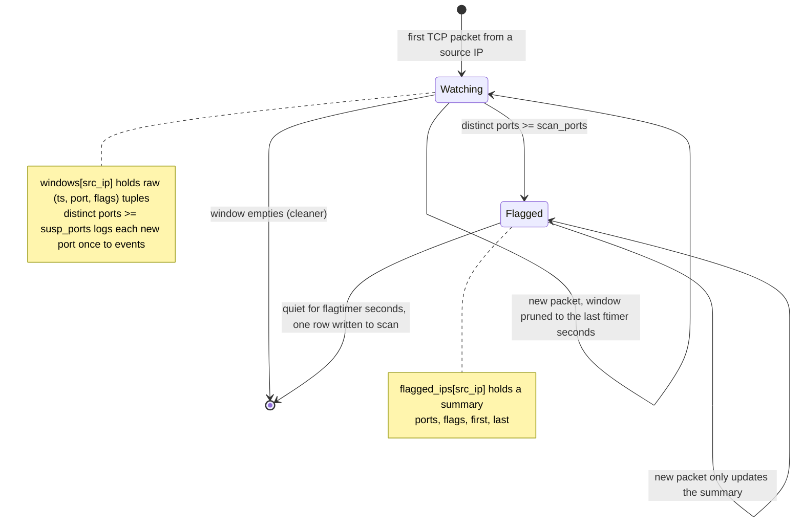

# Stealth Network Monitor

A live network monitoring tool that detects port scans in real time using packet sniffing.

A Scapy-based sniffer captures TCP traffic and runs scan detection in memory. A sliding time window per source IP tracks how many distinct destination ports each source touches. When a source crosses a threshold, it is flagged as a scan; lower activity is logged as suspicious. Confirmed scans are summarized into SQLite once the source goes quiet.

Built to run on a Raspberry Pi alongside a Cowrie honeypot, pairing recon detection and exploitation logging on a single timeline.

## How it works

The tool runs two threads in parallel:

- **Sniffer** (`process_packet`): captures every TCP packet (IPv4 and IPv6) via Scapy's `prn` callback, appends `(timestamp, dst_port, flags)` to an in-memory window keyed by source IP, prunes entries older than the FIFO window, and counts distinct ports to classify activity.
- **Cleaner** (`cleaner`): runs on a timer, prunes stale windows, removes empty keys to avoid memory leaks, and flushes a flagged source to the database once it has gone quiet (so each scan produces one clean summary row).

Detection is a tuned heuristic, not a certainty: thresholds decide when activity counts as suspicious or as a scan, and are meant to be adjusted against a real traffic baseline.

### Classification

| Distinct ports in window | Result |
|---|---|
| `>= scan_ports` (default 6) | flagged as a scan |
| `>= susp_ports` (default 3) | logged to `events` as suspicious (each port once while the source is watched) |
| below threshold | ignored |

Flagged sources stop generating per-packet event rows. Their raw window is replaced by a compact summary (distinct ports, distinct flags, first and last seen), which the cleaner writes as a single row to the `scan` table once the source has been quiet for `flagtimer` seconds.

### Lifecycle of a source IP



A source IP is always in exactly one state. If it comes back after being written to `scan`, it starts over as `Watching`.

### Scan types

- **connect**: handshakes completed normally.
- **stealth**: handshakes abandoned with `R` (half-open / SYN scan signature).

## Data model

Timestamps are stored as Unix floats (easy window math) and converted to readable form only on display.

**`events`** — suspicious, sub-threshold activity:
`id`, `timestamp`, `src_ip`, `des_ip`, `des_port`, `flags`, `severity`

**`scan`** — one summary row per confirmed scan:
`id`, `timestamp`, `src_ip`, `ports`, `port_count`, `duration`, `scan_type`

## Requirements

- Python 3.12+
- `scapy`
- Root privileges (packet capture)

```bash
python -m venv .venv
source .venv/bin/activate
pip install scapy
```

## Settings

All tunables live at the top of the script:

| Setting | Default | Meaning |
|---|---|---|
| `ftimer` | 10 | FIFO window in seconds |
| `flagtimer` | 300 | how long a flagged IP stays tracked before flush |
| `susp_ports` | 3 | distinct ports to count as suspicious |
| `scan_ports` | 6 | distinct ports to count as a scan |
| `scan_interface` | `wlo1` | interface to sniff |
| `cleaner_sweep_time` | 10 | seconds between cleaner sweeps |

## Usage

Scapy needs root, so run from the virtual environment's Python directly, not via an IDE run button:

```bash
sudo .venv/bin/python SNM.py
```

Set `scan_interface` to your active interface (`ip addr` to find it) before running.

## Status

This is **v0.1**, a draft. Core detection (port-spread scan detection, suspicious tier, two-thread sniffer/cleaner, SQLite logging) is implemented, but not yet hardened or extensively field-tested. Both IPv4 and IPv6 traffic are supported.

## Roadmap

Rough priority order.

### Detection correctness
- **Proper stealth detection**: the current `R`-in-window check is a loose heuristic; replace it with real `S -> SA -> R` sequence tracking.
- **Per-destination port counting**: key the window on `(src_ip, dst_ip)` to distinguish scanning one host from normal multi-server traffic.
- **UDP scan detection**: handle connectionless scans (no handshake/flags; infer from ICMP unreachable replies).
- **Threshold tuning**: adjust `susp_ports` / `scan_ports` / window timings against a real traffic baseline.
- **IPv6 prefix grouping**: an IPv6 attacker can rotate source addresses inside their own `/64`; count ports per `/64` prefix instead of per address.

### Reliability & deployment
- **systemd service**: run the sniffer as a managed long-running service instead of a manual script.
- **Production interface config**: swap the VPN tunnel interface for the real capture interface.
- **Quick interface scan**: auto-detect the active interface instead of requiring manual input.
- **Better locking**: harden concurrent access between the sniffer and cleaner threads.

### Observability & interface
- **FastAPI read layer**: endpoints to query events, scans, and stats, with dynamic filtering.
- **Telegram alerts**: push notifications on detection, pull queries on demand.
- **Grafana + Loki dashboard**: live feed and visualization (short retention to avoid hoarding).
- **Terminal interface**: local TUI for live monitoring.
